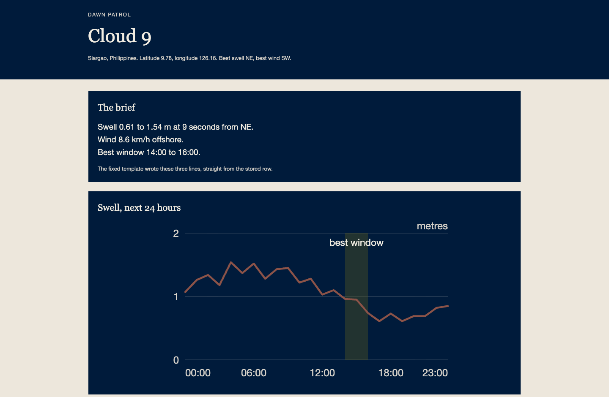
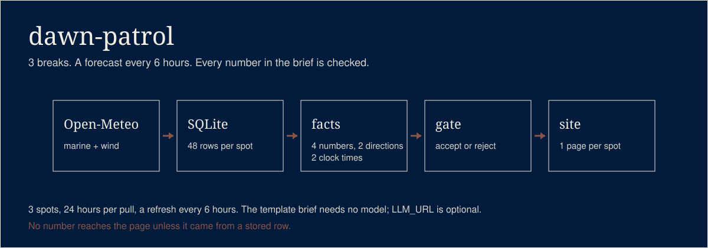
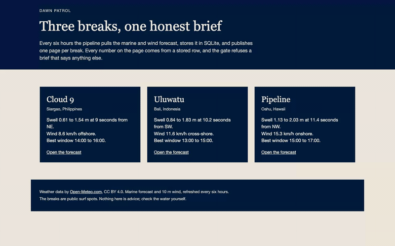

# dawn-patrol

I live on a surf island and check the forecast every morning. This is a small pipeline that pulls
the marine forecast on a schedule, keeps it in a database, and publishes a page with a swell chart
and a three-line brief. A model writes the three lines. Every number in them comes from the data
row, and a test proves it.

## What it does





Three public breaks: Cloud 9 on Siargao, Uluwatu on Bali, and Pipeline on Oahu. Every six hours
a GitHub Actions workflow pulls the marine forecast and the matching wind forecast for each one,
stores both in SQLite, and publishes a static page with a swell chart and a three-line brief.

| Module | Job |
|---|---|
| `dawn_patrol/fixtures.py` | Writes recorded Open-Meteo responses from a fixed seed, and nothing about the network. |
| `dawn_patrol/store.py` | Keeps every pull in SQLite. Ingesting the same pull twice inserts nothing. |
| `dawn_patrol/facts.py` | Turns stored rows into nine facts: a wave range, a period, a swell direction, a wind speed and state, and the best two-hour window. |
| `dawn_patrol/brief.py` | Writes three lines from the facts, with the fixed template or through an optional local model. |
| `dawn_patrol/gate.py` | Reads a draft and the facts, and accepts it only if every number and direction word comes from the facts. |
| `dawn_patrol/site.py` | Renders plain HTML and one inline SVG chart per spot, then swaps the finished folder into place. |
| `dawn_patrol/run.py` | Runs the whole thing: fetch or read fixtures, store, compute, write, publish. |

Everything at runtime is the Python 3.11+ standard library. `pytest` is installed only to test it.

The workflow builds with no model, so the live site always shows the template brief. Point
`LLM_URL` at an OpenAI-compatible endpoint and the brief is phrased by that model instead, still
through the gate.



## How it works

```
 marine forecast ----\
                      >-- SQLite ---- facts ---- brief ---- gate ---- HTML
 wind forecast   ----/       |                                  |
                             |                                  |
                    one row per spot,                    accept: publish
                    per hour, per pull                   reject: template
```

1. **Fetch.** `run.py` asks the two public Open-Meteo endpoints for one day of hourly values:
   `wave_height`, `wave_period` and `wave_direction` from the marine API, and
   `wind_speed_10m` and `wind_direction_10m` from the forecast API. No key, free tier.
2. **Store.** Each response pair is one pull, keyed by the sha256 of its bytes. The pull row and
   one row per spot, per response kind, per forecast hour go into `forecast.sqlite`. A second
   ingest of the same bytes inserts nothing.
3. **Facts.** `facts.py` reads the latest pull and computes the numbers a brief may state. It
   never sees an API response, only stored rows.
4. **Brief.** With `LLM_URL` unset, a fixed template writes the three lines from the facts. With
   it set, the model receives the facts JSON and nothing else, and writes three lines.
5. **Gate.** Every draft, template or model, is parsed. A number that is not a fact, a missing
   fact, a wrong clock time, a direction word that is not in the facts: any of those reject the
   draft and the template is used.
6. **Publish.** The pages are written into `site.tmp-<stamp>/`, then the old folder is moved
   aside and the new one is renamed into place. A reader never sees a half-built site.

### Every number the brief may say

The gate reads these nine keys. The right column is the stored column each one comes from, and
`tests/test_facts.py` asserts that every column exists in the schema.

| Fact key | Source |
|---|---|
| `wave_height_min_m` | `forecast.wave_height_m` |
| `wave_height_max_m` | `forecast.wave_height_m` |
| `period_s` | `forecast.wave_period_s` |
| `wind_speed_kmh` | `forecast.wind_speed_kmh` |
| `best_window_start` | `forecast.valid_utc` |
| `best_window_end` | `forecast.valid_utc` |
| `swell_direction` | `forecast.wave_direction_deg` |
| `wind_direction` | `forecast.wind_direction_deg` |
| `spot` | the name in `spots.toml` |

The best window is the pair of hours with the highest score: calm wind scores high, an offshore
mean wind adds 20, and a mean wave near 1.5 m adds the most. The score is written out in the
docstring of `best_window` in `dawn_patrol/facts.py`. A tie goes to the earlier window.

### A real model brief

The three lines below came from Qwen3.8 Flash Next running on a Mac Mini, given the recorded facts for Cloud 9. The gate accepted them. The same run also produced a draft the gate refused; when that happens the page shows the template instead.

```
NE swell is rolling in with sets from 0.61 m to 1.54 m and a 9.0 seconds period.
Offshore wind at 8.6 km/h is keeping the peaks clean and glassy.
Paddle out between 14:00 and 16:00 for the best window.
```

## Run it

```bash
python3 -m venv .venv
.venv/bin/python -m pip install pytest

python3 -m dawn_patrol.fixtures --seed 7 --out fixtures/
python3 -m dawn_patrol.run --offline fixtures/ --out site/
python3 -m http.server 8000 --directory site
```

Open `http://localhost:8000/`. The first command writes recorded responses, the second runs the
whole pipeline with no network and no model, and the third serves the result.

For the real forecast, the workflow runs this:

```bash
python3 -m dawn_patrol.run --fetch --out site
```

To watch the gate, or to phrase a brief with a local model:

```bash
export LLM_URL=http://localhost:11434/v1
export LLM_MODEL=qwen3.8:27b
export LLM_TIMEOUT=60
python3 -m dawn_patrol.run --fetch --out site
```

`LLM_URL` unset means the template. `LLM_MODEL` defaults to `local-model`. `LLM_TIMEOUT` is the
request timeout in seconds and defaults to 60. A model that is down, slow or wrong never breaks a
run: the draft is rejected and the template is used.

To add a break, add a `[[spots]]` block to `spots.toml` with a name, slug, latitude, longitude,
timezone, best swell direction and best wind direction. Nothing else changes.

## The gate

The brief is the only prose on the page, and a model is allowed to write some of it. So the
brief is the one place where a made-up number could ship. The gate is the answer.

A draft may say a number only if that number is a fact. It must say every fact number. Clock
times must be one of the two window strings, and both must appear. Every direction word must be
one of the top two direction words in the facts, and both must appear. Directions are the 16
compass points plus offshore, onshore, cross-shore and side-shore. Numbers are compared by value,
so 1.20 equals 1.2. The command line prints one line, `ACCEPT` or `REJECT <reason>`, so it is
easy to script and easy to read in a log.

The template brief is written from the facts dict, so it passes by construction. The tests check
that on 60 random days.

## Tests

[](https://github.com/jaysueno/dawn-patrol/actions/workflows/ci.yml)

```bash
.venv/bin/python -m pytest -q
```

CI runs the same `pytest` on Python 3.11 and 3.12. No test touches the network: the fixture
writer is the only source of API data, and the model tests use a fake transport function.

| Rule | Test |
|---|---|
| Two fixture runs at seed 7 are byte-identical | `test_two_runs_at_seed_seven_are_byte_identical` |
| The store is idempotent | `test_store_is_idempotent` |
| The gate rejects an invented number | `test_an_invented_number_is_rejected` |
| The gate rejects a changed direction word | `test_a_changed_swell_direction_is_rejected` |
| The gate rejects a dropped number | `test_a_dropped_number_is_rejected` |
| A unit letter is not read as a compass point | `test_a_unit_letter_is_not_read_as_a_compass_point` |
| Every fact names its source column | `test_every_fact_has_a_named_source_column` |
| The template brief always passes the gate | `test_the_template_brief_always_passes_the_gate` |
| A bad model draft falls back to the template | `test_a_model_draft_with_an_invented_number_falls_back` |
| The offline pipeline publishes one page per spot | `test_the_offline_pipeline_publishes_an_index_and_one_page_per_spot` |

## What it will not do

- It does not predict the surf beyond the public forecast. It republishes Open-Meteo's numbers.
- It does not read a buoy, a camera or a tide table.
- It does not keep history between workflow runs. Each scheduled run pulls fresh and stores into
  a database that lives only in that run. The `--fetch` run on your own machine does keep history
  in `data/forecast.sqlite`.
- It does not run a model unless you set `LLM_URL`. There is no API key, no cloud model and no
  paid call anywhere in the pipeline.
- It does not fix a bad model. It rejects the draft and prints the template. A model that keeps
  failing shows up as a brief that never changes wording.
- It does not check the surf report against the water. Read the page, then look at the sea.
- It does not work offline for the `--fetch` path. `--offline` exists for exactly that.

## License

MIT. See `LICENSE`.

The forecast data comes from [Open-Meteo](https://open-meteo.com/) and is licensed CC BY 4.0.
Every page the build writes carries the attribution and a link to open-meteo.com.
